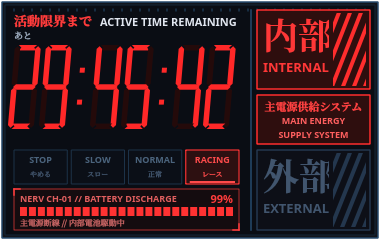

# Countdown Widget / Таймер обратного отсчёта

Легковесный, настраиваемый виджет обратного отсчёта для Linux (X11 / Wayland), который всегда отображается поверх всех окон.

Поддерживает два полноценных скина оформления:
1. **Evangelion (NERV Tactical HUD)** — интерфейс тактического таймера из аниме *Neon Genesis Evangelion* (*«活動限界まで / ACTIVE TIME REMAINING»*).
2. **Classic Minimalist** — лаконичный круглый циферблат с круговым индикатором прогресса.

| Evangelion (NERV Tactical HUD) | Classic Minimalist |
| :---: | :---: |
|  |  |

---

## Особенности (Features)

- **Всегда поверх всех окон (Always-on-Top)**: удобное отслеживание времени во время работы и игр.
- **Два стиля оформления**:
  - **NERV Tactical HUD**:
    - Наклонные 7-сегментные цифры с миллисекундами (`MM:SS:CC`).
    - Динамические индикаторы питания: `EXTERNAL` (внешнее питание при паузе/остановке) и `INTERNAL` + `MAIN ENERGY / SUPPLY SYSTEM` (тревожный красный при работе от внутренней батареи).
    - Переключение режимов: `STOP` (при паузе) и `RACING` (при активном отсчёте).
    - Сегментированная LED-шкала разряда батареи (24 деления) и японская телеметрия NERV в реальном времени.
  - **Classic Circle**:
    - Плавный круговой индикатор прогресса, оставшиеся минуты и секунды.
- **Интуитивное управление**:
  - **Клавиша Space (Пробел)**: быстрый старт / пауза отсчёта (а также мгновенная остановка сигнала тревоги).
  - **Клик ЛКМ**: старт / пауза (при активной тревоге мгновенно отключает звук и сбрасывает таймер).
  - **Перетаскивание мышью**: свободное перемещение в любую точку экрана (позиция сохраняется).
  - **Двойной клик ЛКМ**: быстрый ввод времени в минутах (сохранение по нажатию `Enter`).
  - **ПКМ (Контекстное меню)**:
    - Быстрый выбор таймера (1, 3, 5, 10, 15, 25, 30, 45, 60 мин).
    - Переключение скинов (Evangelion / Минималистичный круг).
    - Включение/отключение звуковых эффектов.
    - Переключение режима «Всегда поверх окон».
    - Сброс таймера и выход.
  - **Ctrl + Колесо мыши**: плавное масштабирование размера виджета.
- **Аудио и уведомления**:
  - **Сигнал тревоги NERV (Evangelion)**: аутентичный звук сирены тревоги NERV при завершении таймера (`alarm.wav`).
  - **Повтор до 10 раз**: сигнал повторяется до 10 циклов, либо моментально отключается по первому клику на виджет или нажатию Space.
  - **Звук старта**: подтверждающий sci-fi тон запуска в стиле консоли NERV (`start.wav`).
  - **Мгновенное глушение**: остановка воспроизведения без задержек при нажатии на виджет.
  - Нативные уведомления через `notify-send`.
- **Минимальное потребление ресурсов**: виджет потребляет минимум CPU/RAM, таймер обновляется только при необходимости.

---

## Установка (Installation)

### Быстрая установка

1. Клонируйте репозиторий:
   ```bash
   git clone https://github.com/remyneron/countdown-widget.git
   cd countdown-widget
   ```

2. Запустите скрипт установки:
   ```bash
   ./install.sh
   ```

Скрипт создаст виртуальное окружение Python, установит зависимости (`PySide6`), добавит исполняемый файл `countdown` в `~/.local/bin` и зарегистрирует приложение в меню системы (`~/.local/share/applications/countdown.desktop`).

---

## Запуск (Usage)

После установки виджет можно запустить:
- Через меню приложений: найти **countdown**
- Через терминал:
  ```bash
  countdown
  ```

---

## Требования (Requirements)

- **Python** 3.10+
- **PySide6** >= 6.5.0
- **Linux** (GNOME, KDE Plasma, XFCE и др.) с поддержкой X11 или XWayland.
- (Опционально) Шрифты с поддержкой японских иероглифов: `Noto Serif CJK JP` / `Noto Sans CJK JP` для максимальной аутентичности скина Evangelion.

---

## Лицензия (License)

MIT License.
